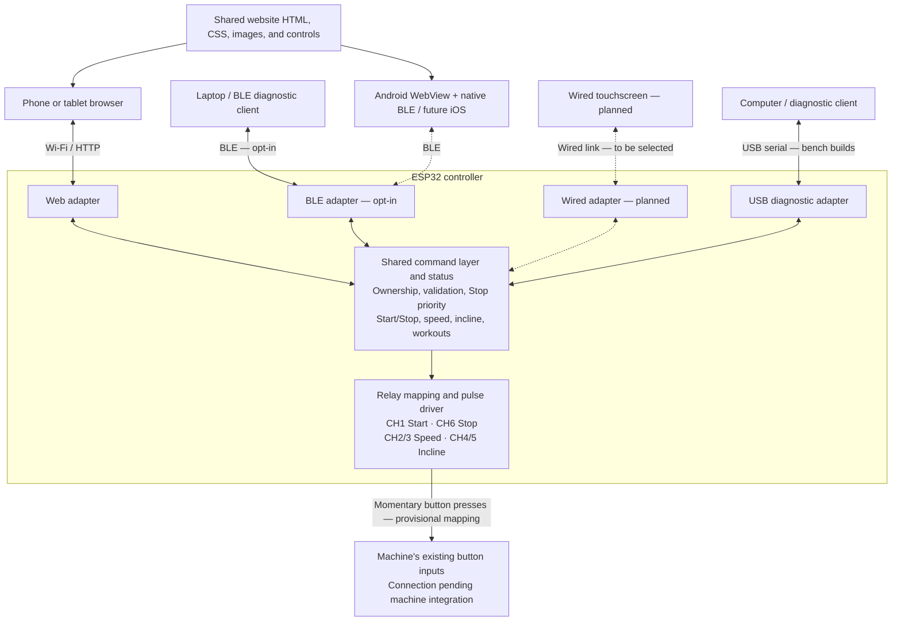

# Nordic Ski Controller

Controller firmware for a custom Nordic ski training machine with a carpeted roller and adjustable incline.

Target: **Waveshare ESP32-S3-ETH-8DI-8RO**, standard Ethernet / isolated RS-485 version, with Wi-Fi and BLE.

## Status

The project uses **ESP-IDF 6.1 and C**. It contains an ESP32-S3 application, a shared control component, desktop tests of that actual component, and an ESP-IDF Unity test application. The previous Python simulator has been removed.

The application boots with an unconfigured controller and runs its control tick independently every 20 ms. It rejects start commands until commissioned limits and healthy interlock feedback are supplied. An opt-in [unloaded relay mode](docs/relay-driver.md) connects the existing controls to configurable relay outputs. Default builds leave it disabled; output-latch acknowledgements do not verify physical contact states. Keep machine wiring disconnected during board bring-up.

The owner selected a controller-hosted Wi-Fi network and browser interface. A password-protected access point and tablet interface are implemented using ESP-IDF. An opt-in [software test mode](docs/software-test.md) supports Start/Stop and speed/incline requests with no physical outputs. Set a local password before flashing; Wi-Fi stays disabled without one. An opt-in [BLE adapter and laptop diagnostic client](docs/ble-client.md) use the same controls and workouts. Laptop BLE controls/workouts and concurrent webpage updates have passed bench testing; two simultaneous BLE centrals, mobile platforms, and longer runs remain to be verified. An [Android-first mobile trial](docs/mobile-trial.md) reuses the website interface inside a React Native WebView with native BLE on the trial branch; physical phone validation, motor control, and measured feedback remain pending. A [local Android emulator with virtual BLE](docs/android-emulator.md) supports laptop testing without physical hardware. Further technology choices require owner approval. See [tablet connection](docs/tablet-connection.md).

## How clients connect

All clients use the same command layer on the ESP32. Wi-Fi/web and USB diagnostics
are implemented; the opt-in BLE adapter adds laptop/phone diagnostic connections.
The Android BLE trial app shares the website interface; physical phone validation and the wired touchscreen remain planned. Dashed connections below mark interfaces awaiting device validation.

Clients can remain connected in parallel. Currently, one client owns control and
can change settings or run workouts; other authorized clients can view status
and send Stop. All clients receive the same controller state. Allowing multiple
clients to change settings simultaneously is a future policy change.

The ESP runs workout timing and relay pulses. Clients never drive relays directly.
Requested speed and incline are settings, not measured motion; the current relay
mapping is not calibrated to physical speed or incline. See the
[shared control contract](docs/control-service.md) and
[USB diagnostic client](docs/usb-client.md) for details.

## Build and test

See [firmware instructions](firmware/README.md) for ESP-IDF installation, building, and board tests. GitHub checks run the C control tests with memory/undefined-behavior sanitizers and compile both ESP32-S3 applications.

The control component implements start/stop, atomic setpoint validation, communication timeout, interlock fault latching, and deliberate reset/restart. It stores requested speed in m/s and incline in percent grade; these are not measured motion or a physical stopping strategy. No operating limits are approved yet.

## Machine integration

The roller drive interface, lift controller, sensors, relay mapping, and stopping/load-holding behavior must be established from the machine documentation. Ordinary ESP32 application firmware is not an independent emergency-stop circuit.

See [relay driver](docs/relay-driver.md), [hardware notes](docs/hardware.md), [control design](docs/control-design.md), and [roadmap](docs/roadmap.md).

Keep credentials out of source control. A public repository does not imply a selected open-source license; licensing remains the owner's decision.

## Interactive local dashboard

Use the [local preview](preview/README.md) to click through the actual webpage without an ESP32. It runs the same C control/session code, serves only on localhost, and never opens a device connection.
