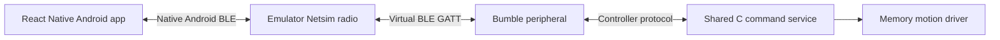

# Android emulator and virtual BLE

This setup runs the native React Native app on this Linux laptop, using free,
local Android tooling. Google Bumble presents a virtual BLE controller through
Android Emulator's Netsim radio. It uses the real C command service with the
memory motion driver. No ESP, physical Bluetooth adapter, USB device, relay, or
Wi-Fi connection is used by the simulator.



This tests Android permissions, pairing, BLE framing, status/catalog delivery,
ownership, Stop, and app lifecycle. It does not establish physical radio
reliability, ESP timing, relay behavior, or iOS behavior. The app now embeds the shared website, including Start, settings, presets, and
Stop. These operate only the memory controller when connected to the simulator.

## Local setup

The local Java 21 and Android SDK paths are described in
[the mobile trial guide](mobile-trial.md). Install these additional SDK packages:

```sh
.local/android-tools/sdk/cmdline-tools/latest/bin/sdkmanager \
  --sdk_root="$PWD/.local/android-tools/sdk" \
  'emulator' 'system-images;android-36;google_apis;x86_64'
python3 -m venv .local/emulator-venv
.local/emulator-venv/bin/pip install -r tools/emulator/requirements.txt
bash tools/emulator/build-controller.sh
```

The C build uses a local C compiler, or the existing ESP-IDF Podman image with
network access disabled. The Linux emulator needs access to `/dev/kvm`.
All SDK packages, the virtual device, bonds, logs, and APKs remain under ignored
`.local/` directories. No Expo account or cloud build is needed.

## Run

Start the emulator in one terminal, then the peripheral in another:

```sh
bash tools/emulator/start.sh
.local/emulator-venv/bin/python tools/emulator/simulator.py
```

The startup script creates the Pixel 4 / API 36 virtual device when needed.
It uses host graphics and disables Vulkan: software graphics crashed on this
laptop, while this configuration booted successfully.

Build and install the separate x86_64 APK from the project root:

```sh
NORDIC_ANDROID_ARCHITECTURES=x86_64 \
NORDIC_ANDROID_APK_NAME=nordic-ski-emulator.apk \
  bash tools/build-android-local.sh
.local/android-tools/sdk/platform-tools/adb -s emulator-5554 install -r \
  .local/artifacts/nordic-ski-emulator.apk
.local/android-tools/sdk/platform-tools/adb -s emulator-5554 shell am start \
  -n com.zdiubaldo.nordicski.trial/.MainActivity
```

Grant Nearby Devices permission, scan, and select **Nordic Ski Simulator**.
The simulation-only pairing code is **123456**. The app's references to the USB
pairing window apply to physical ESP hardware; no USB window is needed here.
The first connection allows two minutes for the system pairing dialog. Ordinary
command replies still time out after ten seconds.

The simulator persists a random BLE identity and bonds across restarts. If its
bond file is deliberately removed, also forget that simulator in Android's
Bluetooth settings before pairing again.

## Exercise the controls

Use the website’s Enable controls, Start/Stop, speed, incline, and preset controls
in the app. The native Disconnect button releases ownership. The simulator's
local socket can inspect state or act as a second logical client:

```sh
.local/emulator-venv/bin/python tools/emulator/simulator.py --control status
.local/emulator-venv/bin/python tools/emulator/simulator.py --control observer_start
.local/emulator-venv/bin/python tools/emulator/simulator.py --control observer_release
.local/emulator-venv/bin/python tools/emulator/simulator.py --control drop
```

`observer_start` claims and starts only the memory controller. While it owns
control the app should show Another client, disable Enable controls, and still
accept Stop. Release that observer before testing app ownership. `drop` closes
virtual BLE links to exercise loss of connection. Reconnect explicitly; the app
must not reclaim ownership or start automatically.

The socket is user-readable/writable only. Redacted events are saved to
`.local/ble-simulator/events.jsonl`; it records command names and results, never
session tokens. `tools/emulator/ui.py` provides UIAutomator inspection, exact
label taps, and screenshots, restricted to `emulator-5554`.

```sh
python3 tools/emulator/test_backend.py
python3 tools/emulator/smoke.py  # start connected as an idle viewer
python3 tools/emulator/ui.py show
python3 tools/emulator/ui.py screenshot connected
```

Physical Android/ESP testing and iPhone validation remain separate acceptance
steps. The existing ARM phone APK is separate from the emulator artifact; rebuild
the default phone target to include subsequent source fixes.

## Initial native-screen validation (2026-10-16)

- Android Emulator 37.2.12, API 36 x86_64, host GPU with Vulkan disabled.
- Native release build and APK signature verification passed. Emulator APK SHA-256:
  `d3e8c731d1b16222f779f6c042ee5dbb03b01bdf20d2e87cb4f99e1ccd3e6e81`.
- Native permission denial produced the expected error; granting permission
  enabled discovery. Authenticated passkey pairing and six-workout catalog
  delivery passed. Bonded reconnect after simulator restart also passed.
- `smoke.py` passed claim/release, disabled claim under another owner, observer
  Stop during a memory workout, background Stop/release/disconnect, bonded
  reconnect with no automatic claim/start, and forced link loss. Link loss
  left the memory controller in fault 2 with no owner, as expected.
- Nine shared-client tests, five native-adapter mock tests, two emulator backend/
  subscription tests, and mobile TypeScript checking passed.
- The simulator was reset after the forced-loss test and the app reconnected as
  an idle viewer. Logs and a screenshot are in `.local/emulator-tests/`.

The tests exposed and fixed a short app pairing deadline and two simulator
issues: subscribing mid-fragment and using Netsim's transient public address as
a bond namespace. None of these tests flashed or operated the physical ESP.

## Shared webpage validation (2026-10-16)

The final shared-interface APK passed the updated `smoke.py` sequence:

- Enable controls, manual Start, speed and incline changes, Stop clearing targets.
- Steady preset Start and Stop through the original website controls.
- Background Stop/release/disconnect and bonded reconnect without automatic control.
- Another client owning control, disabled claim, and observer Stop.
- Forced link loss clearing ownership and returning the app to its connection screen.

The final APK includes a viewer-only keepalive during WebView startup and a
15-second mobile request deadline around the native BLE operation. The original
Wi-Fi deadline and controller watchdog are unchanged. The simulator was reset
following the deliberate fault test, leaving the app as an idle viewer.

Current APK details are in [the mobile trial guide](mobile-trial.md). Test output
is `.local/emulator-tests/shared-page-smoke.log`; screenshots are `shared-web.png`
and `shared-controls.png` in the same directory. The latter shows the original
speed/incline controls, and the former shows the original artwork and layout.
