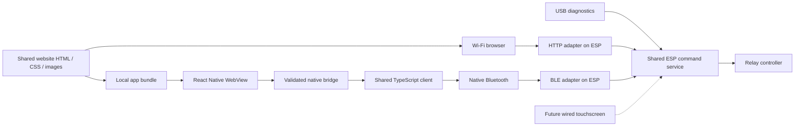

# Android mobile trial

This experiment lives on `codex/android-mobile-trial`. The app uses React Native / Expo for native BLE and a WebView for the shared
website interface, with iOS-compatible source. It does not replace the installed ESP firmware or change the webpage.
The user selected local Android builds; an Expo account is unnecessary.

## What is implemented

- `packages/controller-client`: TypeScript command encoding, BLE framing and
  reassembly, session/sequence/epoch handling, revision barriers, queued-movement
  cancellation after Stop, and an HTTP adapter using the existing endpoints.
- `mobile`: native BLE discovery by service UUID, Android OS bonding, registration,
  status/catalog subscriptions, claim/release, registered-observer Stop, heartbeat,
  explicit disconnect, and reconnect without automatic ownership or movement.
- The existing website runs inside a native WebView: the same HTML, CSS, artwork,
  manual controls, unit selection, workouts, and terrain chart. Only the footer’s
  transport label changes to Bluetooth. A separate native screen handles pairing.

`mobile/scripts/bundle-web.cjs` reads the ESP webpage and embeds its images as
local data URLs. It generates an ignored TypeScript module before builds and
exports. There is no second maintained copy of the interface. The website files
and Wi-Fi firmware are unchanged.

Inside the app, `web-fetch.js` forwards only the four existing API routes to
`WebBridge`. The bridge validates the session, sequence, command, and epoch, uses
the shared TypeScript client over native BLE, and returns the confirmed status in
the shape the website already expects. It waits for the status revision after a
command, so a GATT write alone cannot be displayed as a successful state change.
The app allows 15 seconds for the native BLE request path (the website’s Wi-Fi
path keeps its two-second deadline). Native results still time out after ten
seconds; the ESP contact watchdog is unchanged. A native keepalive preserves
only the viewer registration while the WebView
loads. After the page session handshake, the page sends heartbeats; an
unresponsive page cannot keep a workout alive.
Timeouts and backgrounding close the native session. Remote navigation, network
requests, and file access are disabled for the embedded page.



## Build locally

Use Node 24, pnpm 11.19.0, a JDK 21, Android SDK platform 36, build-tools 36.0.0,
NDK 27.1.12297006, and CMake 3.22.1. On this workstation tools are installed under
ignored `.local/android-tools`. Elsewhere set `JAVA_HOME` and `ANDROID_HOME` to
existing installations. Android SDK components must have their licenses accepted.

```sh
pnpm install --frozen-lockfile
pnpm test:client
pnpm check:mobile
pnpm build:android:local
```

The script generates the native Android project, compiles both ARM architectures,
bundles JavaScript into the APK, and signs it with a generated local trial key.
The result is `.local/artifacts/nordic-ski-trial.apk`. It runs without Metro,
Internet, an Expo account, or an app store. Dependencies must download on the first
build; cached subsequent builds need fewer downloads.

Signing files live in `.local/android-signing` and must stay out of Git. Back up
this directory privately to keep installing upgrades without uninstalling. This
is a separate trial application ID: `com.zdiubaldo.nordicski.trial`. Store release
signing and distribution will be designed later. `mobile/android`, `mobile/ios`,
and build outputs are generated/ignored; do not edit them as the source of truth.
The build script applies local signing after Expo prebuild.

`mobile/eas.json` retains optional development/preview profiles for a future
cloud build; no cloud project, account, paid service, or remote build is created.
Expo Go cannot load this native Bluetooth module.

## Phone acceptance

1. Transfer the APK to the Android phone and allow installation from that source.
2. Keep the controller idle. Open its 120-second USB pairing window using the
   existing `ID ble-pair` command; obtain the code privately from the USB response.
3. In the app, grant Bluetooth permissions, scan, and select the controller. Enter
   the temporary code in the Android system pairing dialog. No code is saved by
   the app. Android 11 and earlier also require location permission for scanning.
4. Verify mode, requested speed/incline, and the six-workout catalog. Connect the
   webpage on another device and verify concurrent status updates.
5. Enable controls while idle, then test Start, speed, incline, Stop, and presets
   on the established unloaded bench. Disconnect releases ownership. With the
   webpage owning control, app claim must be disabled, but app Stop must work.
6. Disconnect and reconnect: the OS bond should persist, ownership must not be
   reclaimed automatically, and Start must never be sent without your action.
7. Test permission denial, Bluetooth off, ESP restart, background/lock, and link
   loss. No old command may be replayed; explicitly reconnect and check state.

While this app owns control it requests screen wakefulness. Leaving the app sends
best-effort Stop/release and closes the BLE session. It sends heartbeats only in
foreground; the existing ESP timeout remains the fallback. System pairing dialogs
are permitted before registration. The final phone-lock policy is still deferred.

## iOS boundary

Android-only permissions and explicit bonding are guarded by platform checks.
iOS uses CoreBluetooth identifiers, the system pairing prompt, and the configured
Bluetooth usage description. The app never assumes a device identifier is a MAC.
An iOS JavaScript export does not prove native compilation, signing, pairing, or
physical device behavior. Those remain unverified until an iPhone build/test.

## Validation

Shared-client tests cover framing, independent streams, UTF-8, out-of-order
fragments, stale revisions, controller restarts, Stop cancellation, epochs,
ambiguous command failures, rejected sequences, and existing HTTP encoding.
TypeScript checks and Android/iOS bundle exports are available locally.
Physical Android BLE acceptance is still required after installing the APK.

### Recorded first milestone results

- Nine shared-client tests and five native-adapter mock tests passed.
- Strict TypeScript checks and existing browser/workout catalog regression suites passed.
- Android native release compilation and release lint passed. The finalized local
  build script completed successfully, including APK signature verification.
- APK: 34.9 MiB, application ID `com.zdiubaldo.nordicski.trial`, version 0.1.0,
  Android API 24 minimum / API 36 target, ARM64 and ARMv7 libraries, embedded
  `assets/index.android.bundle`.
- APK SHA-256: `022ad62e156dccb77963dd51b390090e1a719bc1986b13119ebb7234e1eb2c3f`.
- iOS JavaScript/Hermes export passed; native iOS build and device behavior remain
  unverified. Android phone installation and physical BLE testing also remain pending.
- The original webpage source and ESP firmware are unchanged. Nothing was flashed.

Local build logs are retained in ignored `.local/android-build-verified.log` and
`.local/mobile-ios-export.log`. Future builds may produce a different APK hash.

### Laptop emulator

See [Android emulator and virtual BLE](android-emulator.md) for the free local
API 36 emulator, separate x86_64 APK, and Bumble virtual peripheral backed by
the shared C memory controller. The physical phone acceptance steps still apply.

### Shared website interface validation

The shared-interface release APK is 51.5 MiB and contains ARM64, ARMv7, and x86_64
libraries for phones and this emulator. It was built and signed locally. Current
SHA-256: `bb0dfae6fcaa9a30690f04103df48a6fbc45cc099d07081d1054211fd6c283e8`.
Both `.local/artifacts/nordic-ski-trial.apk` and `nordic-ski-emulator.apk` currently
contain this same universal build. Future default phone builds contain the two
ARM architectures; the emulator build script produces x86_64 only.

Seven bridge/bundling tests, five BLE adapter tests, nine shared-client tests,
TypeScript checks, and the existing webpage/catalog regressions passed. The
bundling test verifies that the shared styles, control script (apart from the
mobile request deadline), logo, and hero image are present in the app.
Physical phone/ESP and native iOS acceptance remain pending.

The final Android emulator acceptance test passed manual Start/settings/Stop,
preset Start/Stop, background cleanup, bonded reconnect without automatic control,
observer Stop, and forced link loss. No physical ESP was flashed or operated.
The final iOS JavaScript/Hermes export also passed; native iOS compilation and
device testing remain unverified.

### Pixel 9 connection check (2026-10-17)

The physical Pixel 9 paired with the ESP using the temporary PIN-free bench
firmware. ESP diagnostics confirmed a stale stored bond rejected earlier pairing
attempts; clearing ESP bonds allowed Android to reach BOND_BONDED.

Subsequent app startup checks exposed MTU 23 and resumed status notifications
arriving mid-message on bonded reconnect. Android now negotiates MTU 247 before
subscriptions and joins each notification stream at its first complete message
boundary. Later framing gaps still close the session. Explicit ATT status 17
resource rejections get at most four whole-message attempts; ambiguous writes
are never retried. Native failure details are preserved in app diagnostics.

The rebuilt APK passed native adapter/bridge tests and TypeScript checks. The
physical phone then displayed the shared controller page and six workouts across
three checks over approximately 30 seconds. Independent USB status confirmed one
connected viewer, idle, fault 0, no control owner, and relay mask 0. Controls were
not enabled during this check; phone relay actuation and longer testing remain
pending. APK SHA-256:
`4ce1d119cfda5d0d7c7e80c98603909d52f0e8308f1d1656a4dc07fe8cfd8761`.
