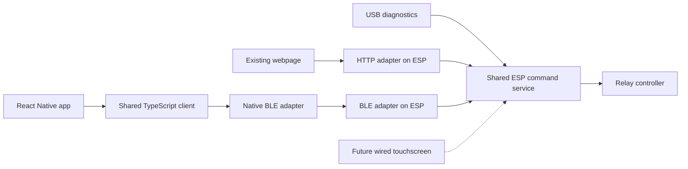

# Android mobile trial

This experiment lives on `codex/android-mobile-trial`. The first milestone adds a
React Native / Expo BLE connection prototype for Android, with iOS-compatible
source. It does not replace the installed ESP firmware or change the webpage.
The user selected local Android builds; an Expo account is unnecessary.

## What is implemented

- `packages/controller-client`: TypeScript command encoding, BLE framing and
  reassembly, session/sequence/epoch handling, revision barriers, queued-movement
  cancellation after Stop, and an HTTP adapter using the existing endpoints.
- `mobile`: native BLE discovery by service UUID, Android OS bonding, registration,
  status/catalog subscriptions, claim/release, registered-observer Stop, heartbeat,
  explicit disconnect, and reconnect without automatic ownership or movement.
- An initial native screen for validating those functions. Start, target editing,
  workout selection, and the finished UI are later milestones.

The HTTP adapter is prepared and tested, but the existing webpage has **not yet
been migrated** onto the package. Its HTML/CSS/JavaScript and ESP embedding remain
unchanged. Migration needs to preserve its existing controls and browser tests.
The shared package contains no React Native imports, so it can serve both clients.



## Build locally

Use Node 24, pnpm 11.19.0, a JDK 21, Android SDK platform 36, build-tools 36.0.0,
NDK 27.1.12297006, and CMake 3.22.1. On this workstation tools are installed under
ignored `.local/android-tools`. Elsewhere set `JAVA_HOME` and `ANDROID_HOME` to
existing installations. Android SDK components must have their licenses accepted.

```sh
pnpm install --frozen-lockfile
pnpm test:client
pnpm check:mobile
pnpm build:android:local
```

The script generates the native Android project, compiles both ARM architectures,
bundles JavaScript into the APK, and signs it with a generated local trial key.
The result is `.local/artifacts/nordic-ski-trial.apk`. It runs without Metro,
Internet, an Expo account, or an app store. Dependencies must download on the first
build; cached subsequent builds need fewer downloads.

Signing files live in `.local/android-signing` and must stay out of Git. Back up
this directory privately to keep installing upgrades without uninstalling. This
is a separate trial application ID: `com.zdiubaldo.nordicski.trial`. Store release
signing and distribution will be designed later. `mobile/android`, `mobile/ios`,
and build outputs are generated/ignored; do not edit them as the source of truth.
The build script applies local signing after Expo prebuild.

`mobile/eas.json` retains optional development/preview profiles for a future
cloud build; no cloud project, account, paid service, or remote build is created.
Expo Go cannot load this native Bluetooth module.

## Phone acceptance

1. Transfer the APK to the Android phone and allow installation from that source.
2. Keep the controller idle. Open its 120-second USB pairing window using the
   existing `ID ble-pair` command; obtain the code privately from the USB response.
3. In the app, grant Bluetooth permissions, scan, and select the controller. Enter
   the temporary code in the Android system pairing dialog. No code is saved by
   the app. Android 11 and earlier also require location permission for scanning.
4. Verify mode, requested speed/incline, and the six-workout catalog. Connect the
   webpage on another device and verify concurrent status updates.
5. Claim/release while idle. With the webpage owning control, app claim must be
   rejected, but app Stop must work. Test actual motion only on the established
   unloaded bench and through the already-approved web controls.
6. Disconnect and reconnect: the OS bond should persist, ownership must not be
   reclaimed automatically, and Start must never be sent by this prototype.
7. Test permission denial, Bluetooth off, ESP restart, background/lock, and link
   loss. No old command may be replayed; explicitly reconnect and check state.

While this app owns control it requests screen wakefulness. Leaving the app sends
best-effort Stop/release and closes the BLE session. It sends heartbeats only in
foreground; the existing ESP timeout remains the fallback. System pairing dialogs
are permitted before registration. The final phone-lock policy is still deferred.

## iOS boundary

Android-only permissions and explicit bonding are guarded by platform checks.
iOS uses CoreBluetooth identifiers, the system pairing prompt, and the configured
Bluetooth usage description. The app never assumes a device identifier is a MAC.
An iOS JavaScript export does not prove native compilation, signing, pairing, or
physical device behavior. Those remain unverified until an iPhone build/test.

## Validation

Shared-client tests cover framing, independent streams, UTF-8, out-of-order
fragments, stale revisions, controller restarts, Stop cancellation, epochs,
ambiguous command failures, rejected sequences, and existing HTTP encoding.
TypeScript checks and Android/iOS bundle exports are available locally.
Physical Android BLE acceptance is still required after installing the APK.

### Recorded first milestone results

- Nine shared-client tests and five native-adapter mock tests passed.
- Strict TypeScript checks and existing browser/workout catalog regression suites passed.
- Android native release compilation and release lint passed. The finalized local
  build script completed successfully, including APK signature verification.
- APK: 34.9 MiB, application ID `com.zdiubaldo.nordicski.trial`, version 0.1.0,
  Android API 24 minimum / API 36 target, ARM64 and ARMv7 libraries, embedded
  `assets/index.android.bundle`.
- APK SHA-256: `022ad62e156dccb77963dd51b390090e1a719bc1986b13119ebb7234e1eb2c3f`.
- iOS JavaScript/Hermes export passed; native iOS build and device behavior remain
  unverified. Android phone installation and physical BLE testing also remain pending.
- The original webpage source and ESP firmware are unchanged. Nothing was flashed.

Local build logs are retained in ignored `.local/android-build-verified.log` and
`.local/mobile-ios-export.log`. Future builds may produce a different APK hash.

### Laptop emulator

See [Android emulator and virtual BLE](android-emulator.md) for the free local
API 36 emulator, separate x86_64 APK, and Bumble virtual peripheral backed by
the shared C memory controller. The physical phone acceptance steps still apply.
